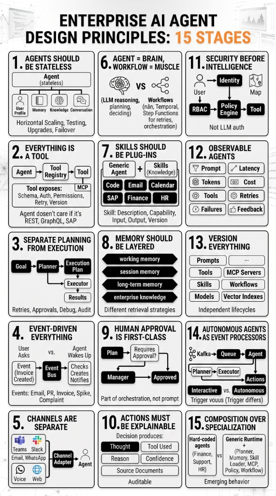

# Enterprise AI Agent Design Principles: 15 Core Stages

**Published:** August 20, 2026  
**Author:** Manoj Kumar P  

---

Building enterprise-grade AI agents requires moving beyond simple LLM wrappers toward durable, secure, and scalable system architecture. Below is a blueprint outlining the 15 fundamental design principles for engineering enterprise AI agents.

*Figure 1: Enterprise AI Agent Design Principles — A 15-stage architectural framework.*

---

### The 15 Core Principles

#### 1. Agents Should Be Stateless
Decouple agent execution from state (user profiles, memory, enterprise knowledge, and conversation history). Keeping agents stateless enables seamless horizontal scaling, instant upgrades, easier testing, and reliable failover.

#### 2. Everything is a Tool
Standardize all external integrations through a unified Tool Registry (such as Model Context Protocol / MCP). The agent interacts via explicit schemas, permissions, auth, and retry policies—abstracting away whether underlying systems are REST APIs, GraphQL endpoints, or legacy SAP services.

#### 3. Separate Planning from Execution
Divide agent operations into two distinct steps: a **Planner** that generates an audit-friendly Execution Plan, and an **Executor** that runs the steps. This separation makes debugging, retries, and human approvals straightforward.

#### 4. Event-Driven Everything
Extend agents beyond synchronous chat interfaces. Connect agents to event buses so they can automatically wake up and take action when real-world system events occur (e.g., invoice generated, pull request opened, customer ticket logged).

#### 5. Channels Are Separate
Decouple input/output messaging channels (Slack, Microsoft Teams, Email, WhatsApp, Web, Voice) from core agent intelligence using dedicated Channel Adapters.

#### 6. Agent = Brain, Workflow = Muscle
Use LLMs for reasoning, context evaluation, and decision-making (the Brain), but rely on durable workflow engines (e.g., Temporal, AWS Step Functions) for stateful orchestration, retries, and execution guarantees (the Muscle).

#### 7. Skills Should Be Plug-ins
Treat domain capabilities (Code, Email, SAP, HR, Finance) as pluggable modules. Generic agents load skills dynamically based on capability descriptions, versioning, and input/output contracts.

#### 8. Memory Should Be Layered
Structure agent memory into distinct layers—working memory, session memory, long-term memory, and enterprise knowledge graph/vector stores—using tailored retrieval strategies for each.

#### 9. Human Approval is First-Class
Incorporate Human-in-the-Loop (HITL) review as a core orchestration primitive rather than relying on prompt instructions. High-risk actions pause for explicit manager approval before proceeding.

#### 10. Actions Must Be Explainable
Ensure every decision produces auditable telemetry: Thought process, Tool Used, Rationale, Confidence score, and Source Documents cited.

#### 11. Security Before Intelligence
Enforce Identity, Role-Based Access Control (RBAC), and policy engines at the API and tool layer. Never rely on the LLM prompt alone to enforce authorization or access limits.

#### 12. Observable Agents
Track fine-grained operational metrics across every execution path: prompt traces, latency, token consumption, financial cost, tool invocations, retries, failures, and user feedback.

#### 13. Version Everything
Maintain independent version lifecycles for all components—prompts, tools, skills, models, MCP servers, workflows, and vector indexes.

#### 14. Autonomous Agents as Event Processors
Architect autonomous agents as queue processors (e.g., consuming from Kafka). Differentiate between interactive user-facing agents and background event-driven processors.

#### 15. Composition Over Specialization
Avoid hardcoding specialized, single-purpose agents (e.g., custom HR bot vs. Support bot). Build generic runtimes that compose dynamic behaviors through runtime planners, skill loaders, memory layers, and policy engines.

---

### Conclusion

Adopting these 15 design principles shifts AI agent development from fragile experimental scripts to robust, enterprise-grade distributed systems. By decoupling state, enforcing security boundaries, and leveraging durable workflow engines, organizations can deploy autonomous agents that are safe, explainable, and scalable.
