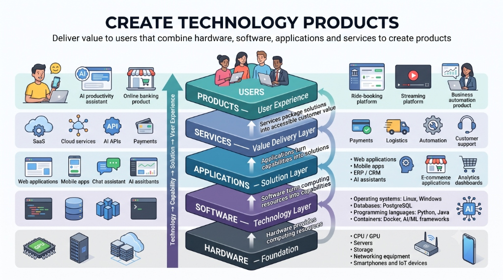

# Can You Generate Value from Executing Business Intellectual Property?

**Published:** August 20, 2026  
**Author:** Manoj Kumar P  

---

### Introduction: The Intellectual Property Paradox

Intellectual Property (IP)—patents, trade secrets, proprietary algorithms, data models, and unique business logic—is often lauded as a company's most valuable asset. Yet, in isolation, IP generates zero enterprise value. A patent gathering dust in a legal vault or a groundbreaking algorithm trapped inside a whitepaper is merely a cost center until it is operationalized.

The fundamental question every technology strategist and business executive must ask is: **How do you bridge the gap between static IP and real-world economic value?**

The answer lies in **execution across the full technology-to-product stack**.

---

### The Technology Product Execution Stack

To transform abstract IP into tangible customer value, organizations must execute across a multi-layered value delivery chain—translating foundational technology into seamless user experiences.

*Figure 1: The Technology Product Stack — How hardware, software, applications, and services converge into end-user products.*

---

### Deconstructing the Value Delivery Layers

#### 1. Hardware — The Foundation
At the base of any technology execution is raw computing infrastructure:
- **Core Elements:** CPUs, GPUs, servers, cloud storage, networking hardware, mobile devices, and IoT endpoints.
- **Role in IP Value Creation:** Hardware provides the computational power required to run modern workloads. Without hardware execution (e.g., specialized GPU clusters for AI models or edge hardware for IoT), complex IP remains purely theoretical.

#### 2. Software — The Technology Layer
Software acts as the bridge that converts raw compute into actionable capabilities:
- **Core Elements:** Operating systems (Linux, Windows), databases (PostgreSQL), programming languages (Python, Java), containers (Docker), and AI/ML frameworks.
- **Role in IP Value Creation:** This is where proprietary logic and algorithms are compiled into software capabilities. It turns raw processing power into scalable, repeatable software operations.

#### 3. Applications — The Solution Layer
Capabilities alone do not solve specific customer problems; they must be structured into target applications:
- **Core Elements:** Web applications, mobile apps, ERP/CRM enterprise platforms, AI assistants, and analytics dashboards.
- **Role in IP Value Creation:** Applications contextualize core IP into functional solutions. A machine learning algorithm becomes a predictive churn model within a CRM, turning technical IP into business functionality.

#### 4. Services — The Value Delivery Layer
Packaging solutions into accessible, reliable, and scalable offerings:
- **Core Elements:** Payments infrastructure, logistics networks, workflow automation, SaaS hosting, customer support, and API gateways.
- **Role in IP Value Creation:** Services remove friction for adoption. They handle compliance, billing, security, and operational reliability so end users can consume the solution effortlessly.

#### 5. Products — The User Experience Layer
The culmination of all lower layers into cohesive end-user products:
- **Core Elements:** AI productivity assistants, online banking platforms, ride-booking services, and streaming platforms.
- **Role in IP Value Creation:** This is where customer value is captured and monetized. End users interact with the product experience, oblivious to the complexity of the underlying hardware, software, and IP, but willing to pay for the outcomes it delivers.

---

### Key Pillars for Unlocking Value from Business IP

1. **Defensibility Meets Speed-to-Market**  
   IP provides defensibility (a legal or technical moat), but execution provides speed and market capture. Operating across all layers ensures competitors cannot easily copy your end-to-end product experience, even if individual components are commoditized.

2. **Continuous Data & Feedback Loops**  
   Executing IP live in production generates telemetry, user interaction data, and operational metrics. This data feeds back into refining the IP (e.g., fine-tuning AI models or optimizing software routines), creating a compounding moat.

3. **Packaging Solutions as Scalable Services**  
   Shifting from selling raw IP (e.g., licensing code snippets or formulas) to delivering hosted, API-driven services dramatically increases margin and lifetime customer value.

---

### Conclusion

Can you generate value from executing business intellectual property? **Yes—in fact, execution is the *only* way to extract value from IP.** 

By orchestrating the entire stack—from foundational hardware and software capabilities up through applications, services, and product user experiences—organizations transform static IP into defensible, revenue-generating technology products.
