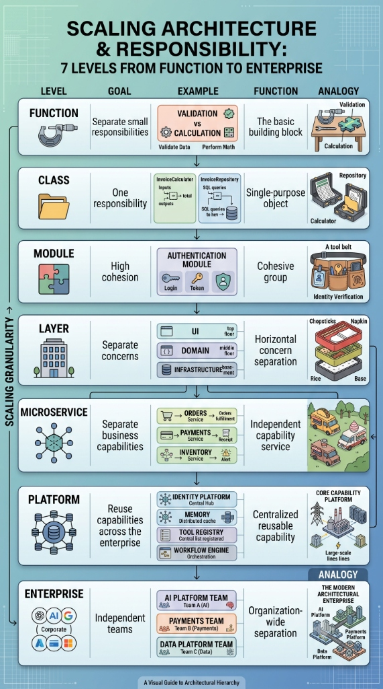

# Scaling Architecture & Responsibility: 7 Levels from Function to Enterprise

**Published:** August 20, 2026  
**Author:** Manoj Kumar P  

---

### Introduction: The Granularity Spectrum of Software Design

One of the fundamental challenges in software engineering and enterprise architecture is deciding how to structure code and system responsibilities as software scales. When systems grow from simple scripts into global platforms built by hundreds of engineers, where should boundaries be drawn? How do you maximize modularity and reuse without introducing unnecessary complexity?

The key lies in understanding **architectural hierarchy**. Modularity and separation of concerns operate at different scales of granularity—from individual lines of code up to organizational team structures.

Below is a comprehensive visual and conceptual guide to the **7 levels of architectural scaling**, detailing the core goals, real-world examples, analogies, and design principles at each level.

*Figure 1: Scaling Architecture & Responsibility — A 7-level visual guide to architectural hierarchy.*

---

### Deconstructing the 7 Levels of Architectural Hierarchy

#### Level 1: Function — Separate Small Responsibilities
- **Goal:** Separate small, discrete execution responsibilities into pure, deterministic building blocks.
- **Scope & Role:** The function is the atomic building block of software logic. Its primary role is to perform one specific operation cleanly—such as isolating data validation logic from mathematical calculation.
- **Analogy:** Precision hand tools (like a micrometer or wrench) on a craftsman's workbench.
- **Best Practice:** Keep functions side-effect-free, highly testable, and focused on a single atomic task.

#### Level 2: Class — Single-Purpose Objects (SRP)
- **Goal:** Enforce the Single Responsibility Principle (SRP) at the object level.
- **Scope & Role:** A class encapsulates state and related behaviors into a cohesive unit. For example, an `InvoiceCalculator` class accepts inputs to compute financial totals, while an `InvoiceRepository` class manages SQL queries to interact with database storage.
- **Analogy:** Specialized office equipment (e.g., a dedicated calculator vs. a structured filing repository cabinet).
- **Best Practice:** Avoid monolithic "God objects." Explicitly separate domain calculation rules from data access and infrastructure logic.

#### Level 3: Module — Cohesive Grouping & Toolbelts
- **Goal:** High cohesion and encapsulation of closely related classes and functions.
- **Scope & Role:** A module packages related capabilities into a unified namespace or library contract. For instance, an `Authentication Module` packages login workflows, JWT token creation, password hashing, and session validation into a single reusable unit.
- **Analogy:** A technician’s specialized tool belt containing all necessary identity verification tools.
- **Best Practice:** Expose a clean, minimal public API while concealing internal implementation details (information hiding).

#### Level 4: Layer — Horizontal Concern Separation
- **Goal:** Separate architectural concerns horizontally across technical boundaries.
- **Scope & Role:** Organize application logic into distinct horizontal floors: **UI / Presentation Layer** (top floor), **Domain / Business Logic Layer** (middle floor), and **Infrastructure / Data Layer** (basement). Dependencies flow strictly downward, preventing UI code from executing SQL queries or tying business logic to specific presentation frameworks.
- **Analogy:** A bento box containing segregated compartments for rice, main dishes, chopsticks, and napkins.
- **Best Practice:** Apply Clean / Hexagonal Architecture principles so core domain rules remain completely independent of external databases, APIs, and UI frameworks.

#### Level 5: Microservice — Independent Business Capabilities
- **Goal:** Separate distinct business domains into independently deployable network services.
- **Scope & Role:** Translate domain-driven design (DDD) bounded contexts into standalone microservices—such as an `Orders Service` for order fulfillment, a `Payments Service` for processing receipts, and an `Inventory Service` for stock alerts.
- **Analogy:** Independent food trucks operating autonomously across a city square.
- **Best Practice:** Ensure each microservice exclusively owns its database store, communicates via clear network contracts (gRPC/REST/Async Events), and can scale or deploy without impacting sibling services.

#### Level 6: Platform — Centralized Reusable Enterprise Capabilities
- **Goal:** Reuse core foundational capabilities across the entire enterprise product ecosystem.
- **Scope & Role:** Centralize complex distributed infrastructure into self-service internal developer platforms. Key platform capabilities include Central Identity Hubs, Distributed Caching & Memory, Tool Registries (e.g., MCP), and Durable Workflow Engines.
- **Analogy:** A municipal power grid delivering reliable energy and utilities to an entire region.
- **Best Practice:** Treat internal platforms as products (Platform Engineering), prioritizing frictionless developer experience (DX), security baselines, and high availability.

#### Level 7: Enterprise — Organization-Wide Team Separation
- **Goal:** Align multi-team organizational structures with architectural domain boundaries (Conway's Law).
- **Scope & Role:** Structure independent, cross-functional engineering organizations (e.g., AI Platform Team, Payments Team, Data Platform Team) that operate autonomously while building toward overarching corporate goals.
- **Analogy:** A modern metropolitan city composed of distinct financial, industrial, and civic districts.
- **Best Practice:** Empower domain teams with end-to-end ownership over their services while maintaining unified enterprise governance, security policies, and architectural standards.

---

### Strategic Takeaways for System Architects

1. **Match Granularity to Problem Scale:** Avoid over-engineering small problems with microservices when simple modules or layered classes suffice. Conversely, prevent monolithic applications from ballooning into multi-team delivery bottlenecks.
2. **Enforce Strict Dependency Flow:** Dependencies should flow downward through layers and inward toward core business logic. Lower-level abstractions should never depend directly on volatile higher-level implementations.
3. **Honor Conway’s Law:** Software architecture and team topology are inextricably linked. Designing clean boundaries at the Microservice, Platform, and Enterprise levels enables teams to ship software independently without constant cross-team coordination overhead.

---

### Conclusion

Mastering architectural hierarchy empowers engineering teams to build software that scales gracefully from a single line of code to global, multi-team enterprise ecosystems. By understanding the distinct goals, boundaries, and trade-offs of each level—from atomic Functions up to Enterprise Platforms—organizations establish a solid foundation for long-term modularity, code reuse, and sustainable engineering velocity.
